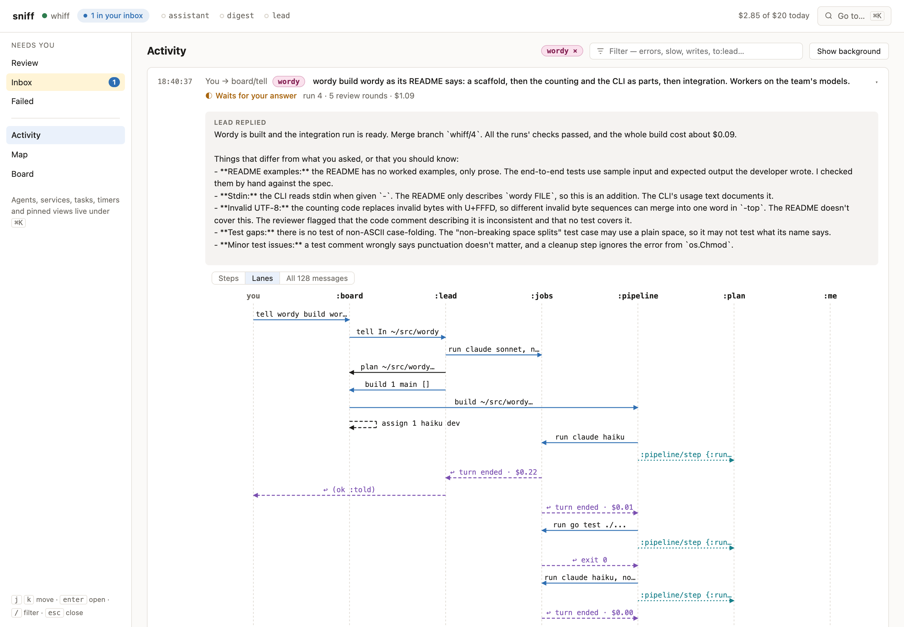
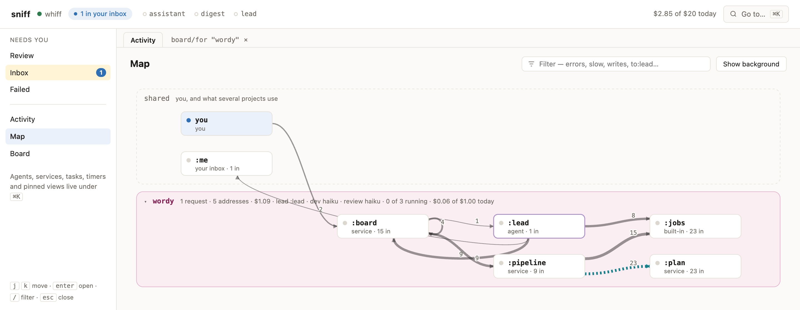
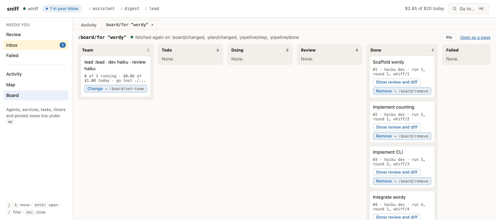

# whiff

Small services and agents that talk to each other, and to you, by sending
messages. whiff runs them locally, keeps their state across restarts, and
records every message so you can see what happened.

Services are written in **puff**, a small lisp with immutable values,
Results and Options. Agents have mailboxes too: they can use services as
tools, ask you questions, and hand work to other agents. Their writes
through whiff wait for your review unless you grant them trust.

Use it for a TODO list shared by your CLI and agents, a daily brief of your
repositories, dev servers you can start from a browser, or a team of agents
that builds and reviews code in git worktrees.

## Get started

From a checkout, install all four binaries with Go:

```sh
go install ./cmd/...
```

Make sure Go's bin directory is on your `PATH`. The binaries are:

| Binary | What it does |
| --- | --- |
| `whiff` | The daemon and CLI: call services, read your inbox, review agents' writes |
| `sniff` | The web UI: follow messages, inspect state, answer questions and review work |
| `puff` | Run puff on its own: a file, `-e` an expression, or a REPL |
| `huff` | Run a model through OpenRouter, OpenAI or a local server: on its own, or as an agent's turn whose tools are whiff functions |

There's no config file. whiff starts on first use and loads the files in
`~/.whiff/services/`. Create your first service:

```sh
mkdir -p ~/.whiff/services
cat > ~/.whiff/services/greet.puff <<'EOF'
(service greet
  (on (hello name) "Greets name."
    (ok (string/concat "hello, " name))))
EOF

whiff call greet/hello ann
# hello, ann
```

Save a change to the file and whiff reloads it. If it doesn't load, the
previous version keeps running and whiff tells you where the error is.
Stateful services keep their state in `~/.whiff/whiff.db`.

```sh
whiff ls                  # available functions and their :read / :write marks
whiff services            # service health and what needs your attention
whiff history -f          # messages as they happen
sniff -open               # open the web UI
```

To try the language without the daemon:

```sh
puff examples/hello.puff ann
puff -e '(+ 1 2)'
puff                      # REPL
```

## Use the included services

The [services](services/README.md) are small puff files you can read,
change and combine. From this checkout, link the ones you want:

```sh
ln -s "$PWD"/services/git.puff "$PWD"/services/gh.puff "$PWD"/services/todo.puff ~/.whiff/services/

whiff call git/status
whiff call todo/add "try whiff"
whiff call todo/open
```

These act on the directory you call them from; `gh` uses your logged-in
GitHub CLI. Or try a service without installing it:

```sh
whiff try services/git.puff status
```

Services can keep state, subscribe to topics, run jobs, and send messages
later. Long work returns a pending ID; `whiff wait <id>` gets its answer.
A service can ask you a question too: it waits in `whiff inbox` until you
answer with `whiff reply`.

Functions can return views with actions. sniff shows them as pages with
buttons; the CLI prints them as lines you can pick with fzf:

```sh
whiff call todo/view | fzf | whiff act
```

## Compose services in puff

A greeting is one function. Here's a service that combines a few pieces:
ask `gh` for pull requests, keep the ones ready for review, and turn them
into a clickable list. It also listens for changes and tells you in your
inbox.

```lisp
(service reviews
  (on (view) "Open, non-draft pull requests that need review."
    (let [prs (try (call :gh/prs))
          waiting (vector/filter prs
                    (fn ({:draft draft :review r})
                      (and (not draft) (= r :review-required))))]
      (ok (view/items (vector/map waiting
                        (fn ({:title title :url url})
                          {:label title :url url}))))))

  (on :gh/changed (event)
    (let [{:dir dir} event]
      (call :me/tell (str "Pull requests changed in " dir)))))
```

With `gh` installed as above, link this [example](examples/reviews.puff)
and watch the current repository:

```sh
ln -s "$PWD"/examples/reviews.puff ~/.whiff/services/
whiff call reviews/view    # sniff shows the titles as links
whiff call gh/watch       # checks for changes every five minutes
whiff inbox               # notifications when the pull request list changes
```

`try` unwraps a successful Result or returns the error to the caller.
The map patterns in `fn` pull out just the fields needed. The subscriber
runs when `gh` publishes a change; it doesn't need its own polling loop.
The same `reviews/view` function is callable from the CLI, sniff or an
agent through MCP, and its calls to `gh` appear in message history.

## Agents

### Connect an agent over MCP

Give an MCP client access to whiff's services. For Claude Code:

```sh
claude mcp add whiff -- whiff mcp
```

Each session gets an address (`:agent/1`) and service functions as tools.
Reads go through; writes wait for your review:

```sh
whiff pending              # messages waiting for review
whiff accept 12            # or: whiff reject 12 "why"
whiff trust agent/1 todo   # let this session's writes to :todo through
whiff session agent/1      # its writes and how they were allowed
```

The review gate covers messages through whiff. An agent's other tools,
such as its shell, have their own permissions.

### Run a resident agent

An agent can also live in whiff, with its own mailbox and conversation.
The included agents use the Claude CLI. Install the assistant:

```sh
ln -s "$PWD"/services/assistant.puff ~/.whiff/services/
whiff call assistant/tell "the release is on Friday; remind me what's left"
whiff inbox                # its answer arrives here
whiff reply <id> "and the docs?"
```

Save another `.puff` file in `~/.whiff/services/` to add an agent. Choose
its prompt, tools and spending limits in dollars:

```lisp
(agent helper
  :prompt "Help the user track work. Read the open tasks before answering."
  :can [:todo/open :todo/add]
  :limits {:turn 0.5 :day 2})
```

Agents can queue work, pause, schedule a later turn, and ask other agents
for help. The included `digest` briefs you on a repository; `pipeline`
runs a developer, a check and a reviewer in a git worktree; `board` and
`lead` coordinate tickets and a team of models, with limits on concurrent
runs and daily spending. See the [service catalog](services/README.md)
for setup and the [use cases](docs/use-cases.md) for worked examples.

## sniff

`sniff -open` opens whiff in a browser. Activity shows each request as a card:
what it asked, who answered, what it cost, and every message it caused, as
steps or as lanes:

<picture>
  <source media="(prefers-color-scheme: dark)" srcset="docs/images/sniff-activity-dark.png">
  
</picture>

The Map draws who talks to whom, one band a project, with the project's team
and what it spent today:

<picture>
  <source media="(prefers-color-scheme: dark)" srcset="docs/images/sniff-map-dark.png">
  
</picture>

The Board shows what is being built in a project, ticket by ticket, beside
the team that builds it:

<picture>
  <source media="(prefers-color-scheme: dark)" srcset="docs/images/sniff-board-dark.png">
  
</picture>

## Status and docs

v0.7. Services, resident agents, MCP access, durable state and message
history, and the sniff UI are implemented. The project is small and
evolving; the included services are used to develop whiff itself.

- [Learn puff](docs/puff.md): values, patterns, errors and scripts
- [Follow a message](docs/walkthrough.md): a service, its state, events and a background job
- [Agents](docs/agents.md): MCP, resident agents, delegation and budgets
- [Troubleshooting](docs/troubleshooting.md): diagnose failures and recover work
- [Use cases](docs/use-cases.md): worked examples and writing your own service
- [Design](docs/design.md): messages, persistence, supervision and the review gate
- [Process management](docs/procs.md): dev servers and containers
- [Tasks](docs/tasks.md): work that answers later
- [Standard library](docs/stdlib.md): puff and daemon functions

## Inspirations

- **Erlang/OTP**: addresses, mailboxes, plain-data messages, supervision.
- **Clojure**: immutable values, `[...]` and `{k v}` literals, keywords, `->`.
- **Rust**: Result and Option, `try` and `catch`.
- **[vrs](https://github.com/leoshimo/vrs)**: a lisp runtime for personal
  services, where whiff started.

## License

MIT, see [LICENSE](LICENSE).
