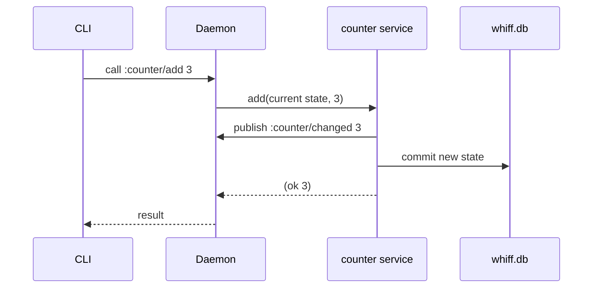

# Follow a message

This walkthrough follows a request from the CLI to a service, through a
state update and reply, then adds an event and a background job. It uses
only whiff and Go; there are no model calls or external services.

Install the binaries from a whiff checkout with `go install ./cmd/...` and
put Go's bin directory on your `PATH`. For the language itself, start with
[Learn puff](puff.md).

## A service that counts

Save this as `~/.whiff/services/counter.puff`, creating the directory if
needed:

```lisp
(service counter :state {:total 0 :last (none)}
  (on (add state amount) :update "Adds amount and publishes the new total."
    (let [total (+ (unwrap (map/get state :total)) amount)]
      (do (try (publish :counter/changed total))
        (ok [total (map/set state :total total)]))))

  (on (snapshot state) "The current total and last job result."
    (ok state))

  (on (check state) "Runs go version in the background."
    (submitted (call :jobs/run ["go" "version"] {:as :text})))

  (on (whiff/done state id result) :update "Stores the job's result."
    (ok (map/set state :last (some result)))))
```

The file names the address `:counter`. Its handlers are functions at that
address: `:counter/add`, `:counter/snapshot` and `:counter/check`.
`:state` provides an initial value. Every handler receives the current
state as its first parameter; callers supply only the remaining ones.

```sh
whiff call counter/add 3
# 3
whiff call counter/snapshot
# {:last (none) :total 3}
```

These outputs assume a fresh counter. whiff starts on first use, loads
the service and routes the request. A second add starts from the saved
total, rather than the initial zero.

## What happened to the request



The CLI connects to the per-user Unix socket and reads `3` as a puff int.
The daemon finds `:counter` and puts the request in its mailbox. The
service handles messages one at a time, so two adds cannot both read the
same old total and overwrite each other.

The `:update` handler returns `(ok [reply new-state])`. whiff commits the
new state before it sends the reply. The CLI unwraps `(ok 3)` and prints
`3`; `whiff eval '(call :counter/add 3)'` would print the Result itself.
The daemon records the call, reply and the publish it caused in history.

The publish happens inside the handler, before its state commit. State
and external effects aren't one transaction: a subscriber should use the
event's total, and a crash could cause an effect to happen again. The
[design document](design.md) explains the durability guarantees.

## Watch the event and the history

In another terminal, subscribe before sending the next add:

```sh
whiff sub counter/changed
```

Then call `whiff call counter/add 2` in the first terminal. The total is
now 5, and the subscriber receives 5. Publishing tells every subscriber;
it doesn't wait for their handlers to finish. A service can subscribe
with `(on :counter/changed (value) ...)` too.

Inspect the request and what it caused:

```sh
whiff history -c to:counter/add
whiff history -f
sniff -open
```

`-c` groups messages into chains. This add and its publish belong to one
chain; a timer firing later begins a new chain. History includes the
origin, sender, target, arguments, reply and elapsed time. In sniff,
Activity shows the request and its steps; Map shows which addresses talk.

## Let a job answer later

The `check` handler starts a process as a daemon job:

```sh
whiff call counter/check
# prints the job's numeric ID; use that ID below
whiff wait <id>
# go version ...
```

The call to `:jobs/run` returns a pending Result immediately:
`(err {:kind :pending :id ...})`. It means whiff accepted the task and
owes a result. `submitted` converts it to `(ok id)`, so `counter/check`
can reply now while keeping ownership of the job's result. A real
submission failure, such as a missing executable, remains an error.

When the process ends, whiff stores its result before notifying anyone.
Because `:as :text` was requested, exit 0 produces `(ok "go version ...")`.
The counter receives `[:whiff/done id result]`. Its `whiff/done` handler
stores the result under `:last`; unlike an ordinary update handler, it
returns `(ok new-state)` because there is no synchronous reply to send.

```sh
whiff state counter
whiff call tasks/tree <id>
```

`whiff wait` can see the stored job result before the counter has handled
its notification. Once that handler commits, `:last` contains
`(some (ok "go version ..."))`, or `(some (err ...))` if the job failed.

To give the job directly to the caller instead, use `hand-on` in place of
`submitted`. The caller then receives pending and waits for the final
result; the counter no longer owns that completion. See
[Tasks](tasks.md) for ownership, cancellation and retries.

## Reload, restart and inspect

Saving the file reloads its code while retaining the committed state.
`whiff stop` stops the daemon and its jobs; the next whiff command starts
it again, and `counter/snapshot` still has the committed total.
The `:state` literal is the initial value, not a reset on every load.

```sh
whiff services counter
whiff ls
```

`add` is `:write` because it updates state and publishes. `snapshot` is
`:read`. Marks are inferred from the handler's behavior; `whiff ls` shows
them. Calls from an agent pass through the review gate, so the same
service can be used from the CLI, sniff and an agent with different
review rules. Continue with [Agents](agents.md) for those rules, or
[Troubleshooting](troubleshooting.md) when a message doesn't go where
you expected.
